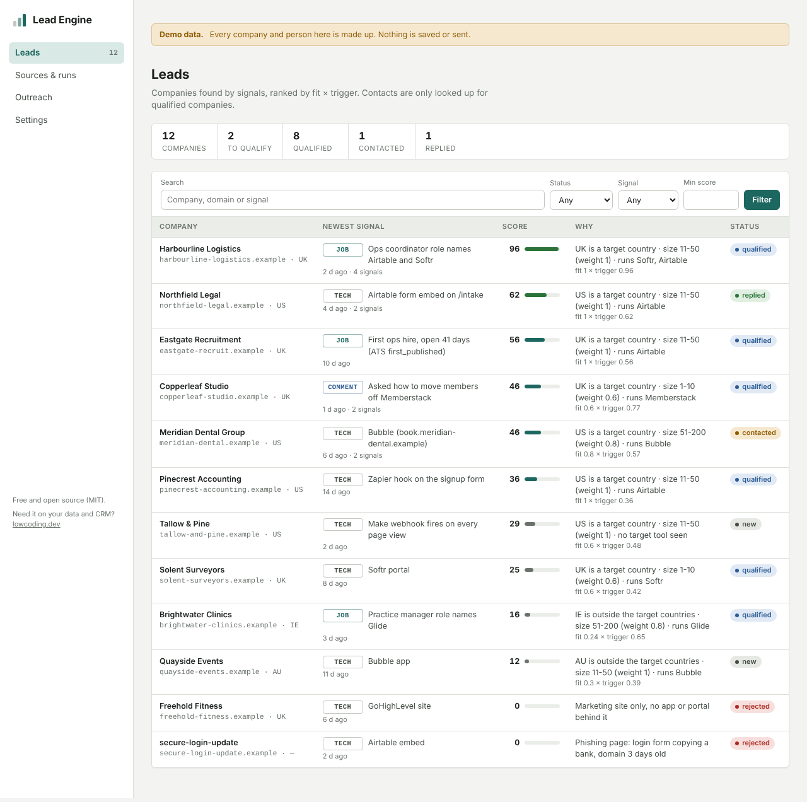
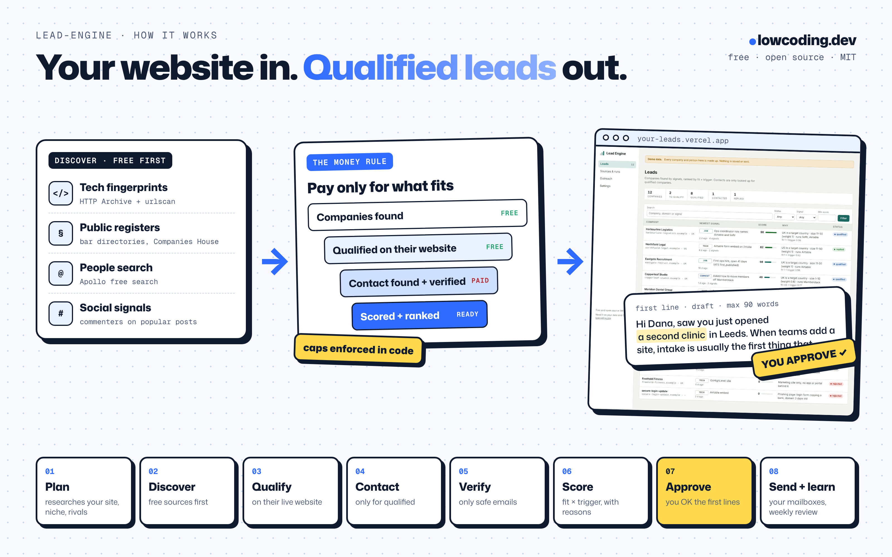

# Lead Engine

A lead search engine that runs as a process inside Claude Code.
It finds companies by signals (the tools they run on, public registers, job posts, comments on popular posts), checks each one on its own website, looks up and verifies contacts only for the ones that fit, ranks them with written reasons, drafts the first emails and sends them from your own warmed mailboxes.
One command sets it all up. It starts by researching your website, niche and competitors and shows you a plan: which channels fit, which services you need and what they cost, a timeline, and a mock of your dashboard in your colours. You approve it; then it builds only what the plan needs, in one of three modes: on Supabase + Vercel (hosted), on your own host and database (hosted), or with no app at all on your own computer (everything runs from Claude Code there and the dashboard is a generated page).

**You need a paid Claude plan** (Pro, Max, Team or Enterprise) **or Anthropic API credits**: the free claude.ai plan does not include Claude Code. The bundle itself is free (MIT).



*Screenshots use the built-in demo data (`npm run demo`). Every company and person in them is made up.*

## How it works



The rule that keeps it cheap is enforced in code, not in a prompt: **discover free, qualify on the website, pay for contacts only on qualified companies, verify, then send.** The app refuses a paid lookup on an unqualified company, refuses the same paid call twice inside 24 hours, and refuses anything over your daily or monthly cap.

## Install

**Claude Code on your computer** (2 commands):

```
/plugin marketplace add hichock/lead-engine
/plugin install lead-engine@lowcoding-leads
```

Then open an empty folder and run `/lead-engine:setup`.

**Claude Code in the cloud (claude.ai/code), to run it hosted:** connect the Supabase and Vercel connectors in
claude.ai (Settings → Connectors), start a session on an empty private GitHub repo and type
`Set up lead-engine from github.com/hichock/lead-engine`. Plugins don't load in cloud sessions, so setup clones this
repo and follows `skills/setup/SKILL.md`. It builds mode A: the app on Vercel and Supabase sends and reads replies on
its own schedule, and your cloud scheduled tasks call it over HTTPS. Mode C (no app) is not offered in the cloud.

## What setup does

`/lead-engine:setup` is a checklist that saves its progress in `kb/setup-state.md`, so a failed step resumes instead of starting over. There is no question round: you approve a plan, confirm the mode in one line, and give logins or keys only where a step can't run without them.

1. **Checks what you already have:** connectors in the session (Supabase, Vercel, GitHub, Zapmail), logged-in CLIs, keys already set, and the repo. In a cloud session it uses the attached repo (if it's empty), asks before adding to a repo with code, and explains how to attach a new one; on your computer it can create a private repo with `gh`.
2. **Copies the app and the kit** into the folder: the Next.js app, migrations, tests, `CLAUDE.md`, `kb/`, the skills, hooks and an optional GitHub Actions workflow.
3. **Researches and plans** (the `plan` skill): your company, offer, buyers, niche and competitors (and the tools and channels they use). It picks 2 to 4 channels with reasons, lists the services with costs, gives a timeline with milestones (no promised reply rates), and builds a dashboard mock with example data in your brand. Output: `kb/plan.md` and `docs/plan.html`. You approve or edit it.
4. **Picks the mode** from what you have and confirms it in one line:
   - **A. Supabase + Vercel** (default; free tiers are fine to start).
   - **B. Your own host and database:** any Node host (Railway, Render, Fly, a VPS) and your Supabase project; env vars and cron alternatives in `template/HOSTING.md`.
   - **C. No app, on your computer:** everything runs from Claude Code with a local SQLite store (or your own Postgres); the dashboard is a generated HTML page refreshed by each run; sending through your own mailboxes (SMTP) or a CSV for your sequencer. It runs while your computer is on. Not in a cloud session: those allow only web traffic, so they can't reach Postgres, SMTP or IMAP, and their files don't last (measured 2026-11-12).
5. **Builds only what the plan needs:** repo, database, deploy and sign-in check (A, B), or the local store (C). Connectors first, CLIs second. Step-by-step guides for every service are in `skills/setup/references/guides/`.
6. **Adds the keys the plan's channels need**, free first (urlscan, Google BigQuery), MillionVerifier before the first send.
7. **Schedules the jobs:** sending, replies and daily pulls (pg_cron, your host's scheduler, or `le send` / `le replies` in mode C), and the Claude runs (scheduled tasks or GitHub Actions).
8. **Does the first free run** on the plan's first channel and qualifies the first 20 companies.
9. **Shows where everything is and what happens next.**

## What you need

- **A paid Claude plan or API credits.** Claude Code needs a Pro, Max, Team or Enterprise plan, or an Anthropic Console (API) account billed per use; the free claude.ai plan does not include it (sourced: code.claude.com/docs/en/setup, read 2026-11-12). Scheduled runs use the same plan.
- A GitHub account.
- Mode A: a Supabase account (the free plan works to start; free projects pause when idle) and a Vercel account (Hobby is for personal, non-commercial use, so a business should use Pro). Mode B: your own host and Supabase project. Mode C: your own computer with Node 22.13+, nothing else.
- For sign-in emails to anyone who is not a member of your Supabase organization (teammates, or you with another address): your own email sending in Supabase (custom SMTP, for example Resend's free plan), because Supabase's built-in email only reaches organization members, 2 an hour (Supabase docs, read 2026-11-12). Guide: `skills/setup/references/guides/supabase.md` → "Email".
- For sending: one or more secondary domains with warmed mailboxes (Google Workspace or Microsoft 365). Never your main domain.

## Costs

The bundle is free; running it needs your paid Claude plan or API usage (see What you need). These are the outside services, with the default caps the app enforces. Prices were checked or measured in October and November 2026; check the provider before you pay. Sign-up links, free tiers and current discounts for every tool are in one file, [`kit/kb/tools.md`](kit/kb/tools.md). Some of those links are the author's referral links (you pay the same; it says so in the file).

| Service | Free tier | Paid | Default cap in the app |
|---|---|---|---|
| HTTP Archive on Google BigQuery | 1 TB of queries a month; one tech export over a monthly crawl scanned about 2.9 GB in our runs | pay per TB above the free tier | 30 GB a day, 200 GB per query, dry run before every query |
| urlscan.io | 1,000 searches a day, public scans of the last 30 days | paid plans exist | 200 searches a day |
| Apollo people search | free (only the free search endpoint is called) | credits for enrichment are never used | 20 pages a day |
| MillionVerifier | none worth counting | about $0.0037 per check on one-time packs | 80 checks a day |
| Monid (Hunter, ContactOut and more) | $1 credit | pay per call, e.g. $0.012 per Hunter verify, $0.10 per ContactOut email found | $1.50 a day |
| Apify (LinkedIn comments, profile activity) | small monthly credit on the free plan | about $2 per 1,000 comments | $0 (off) until you set a budget |
| All paid sources together | | | $30 a month |
| Supabase | free plan | Pro from $25 a month | |
| Vercel | Hobby (non-commercial) | Pro $20 per user a month | |
| Mailboxes | | for example Zapmail pre-warmed Starter: $39 first month for 3 mailboxes on 1 domain, then $24 | 15 emails a day per mailbox |

In our own runs a full daily run (about 3,000 domains screened, 110 to 170 pages checked, about 25 leads queued) cost $0.40 to $0.70 of Monid, 50 to 60 MillionVerifier checks and 21 to 26 GB of BigQuery (measured 2026-11-05 and 2026-11-06).

## Skills

The plugin carries only `setup`. Setup copies the worker skills into your repo (`.claude/skills/`), because plugins don't load in cloud sessions or scheduled tasks and repo skills do. `CLAUDE.md` has a routing table so plain requests ("find companies using Airtable in the UK") reach the right skill.

| Skill | What it does | Paid calls |
|---|---|---|
| `/lead-engine:setup` | Environment check, plan, mode, repo, database or local store, deploy, schedules, first run | none |
| `plan` | Researches the site, niche and competitors; channels, services and cost, timeline, dashboard mock; asks for approval | none |
| `report` | The dashboard as one HTML file (mode C, or a mock in your brand) | none |
| `get-help` | Sends your problem to the bundle's author (no secrets; confirms how to reach you); logs the request id | none |
| `source-tech` | Companies by the tool they run: HTTP Archive (dry run, poll, never re-run) and urlscan date slices; schedules daily pulls | none |
| `source-registers` | Professional registers and directories via small adapters; emails only where the register publishes them | none |
| `source-people` | Apollo free people search, domain guess, site scan | none |
| `source-social` | Fast-rising posts by velocity against each author's median, commenter harvest, buyer classification | Apify, capped |
| `source-signals` | Job posts with original ATS dates, ads running, reviews, added as dated signals | none (Apify optional) |
| `qualify` | Live site check, the gates in `kb/icp.md`, one evidence line per company | none |
| `find-contact` | Cheapest-first waterfall, qualified companies only | Monid, capped |
| `verify` | MillionVerifier, Monid Hunter for unknowns; only `ok` is sendable | yes, capped |
| `activity-research` | A prospect's own comments and reactions, once, to pick the right offer | Apify, capped |
| `score` | fit x trigger with written reasons; you change weights, never scores | none |
| `first-lines` | Email 1 and two follow-ups from the strongest measured fact, reviewer pass, saved as drafts | none |
| `outreach-review` | Manual or scheduled: reply classes and draft answers, stop-loss, queue if auto-queue is on, weekly kill or scale | none |
| `kb-keeper`, `kb-tidy` | Keep the knowledge base current and short | none |

Each skill starts by reading `kb/RULES.md`, `kb/context.md` and its domain files, and ends by writing a run note and updating source yields. The concrete findings (queries, actor IDs, endpoints, costs, yields, pitfalls) are in each skill's `references/` folder, with their dates.

## Scheduled runs

| What | Where | When |
|---|---|---|
| Daily urlscan pulls for your tools | app (Supabase pg_cron) | daily |
| Send tick: one email per mailbox, inside each lead's Mon to Fri working hours | app | every 5 minutes on weekdays |
| Read replies and bounces, stop the sequence, forward replies to you | app | every 15 minutes |
| Qualify, find contacts, verify, score, draft | Claude scheduled task (or GitHub Actions) | weekday mornings |
| Outreach review: replies, stop-loss, queue | Claude scheduled task | weekday afternoons |
| Weekly review and knowledge base tidy | Claude scheduled task | Mondays |

The app does the fetching and sending, which needs no model. Claude does the judging and writing. In mode C there is no app: `node scripts/le.mjs send` and `replies` run from your computer's scheduler and the Claude runs from Claude Code desktop scheduled tasks, with the same send rules, while the computer is on (see `skills/setup/references/scheduling.md`). Cloud scheduled tasks work with mode A or B only.

## The knowledge base

`kb/` is the system's memory, and it is plain markdown in your repo:

- `context.md`, `offer.md`, `icp.md`, `voice.md`: your business, your offer, who buys, how you write. Drafted from your website at setup.
- `plan.md`: the approved plan (channels, services and cost, timeline, mode); the page version is `docs/plan.html`.
- `tools.md`: every tool with its sign-up link, free tier, price and known discounts. Skills and setup link to tools only through this file.
- `playbook.md`: an index of the outreach best practices (stage order, signal tables, copy and subject rules, sequence timing, stop-loss, reply classes, email plus call, sending infrastructure, partner channels, compliance, and the non-obvious channels we found: doc-share, viral-post commenters with per-prospect activity research, technology search, registers with named emails, Apollo free search with domain guess, job-post signals). Each rule lives in one skill reference file.
- `sources.md`: one row per source with access, cost, cap per run and yield to date. Skills update it after every run.
- `decisions.md`: every rule and choice, newest first, with the reason. Owner corrections become rules here so they never happen twice.
- `findings.md`, `runs/`, `research/`: what broke, what ran, what was researched.
- `RULES.md`: how to read and write all of the above. Every number is labelled measured, sourced, stated, assumed or needs input. One fact lives in one place. No secrets and no lists of people.

A session-start hook prints the map, the latest decisions and any unfinished setup step at the start of every session, including cloud sessions and scheduled tasks.

## Guardrails built into the app (and the local runner in mode C, which uses the same code)

- **Caps per run day and per month**, checked before every paid call (`lib/guard.ts`, tested).
- **Paid contact work only on qualified companies with an evidence line**, refused in code with a test that proves no provider is called.
- **Run ledger:** the same source and input inside 24 hours is refused, by the app and by a database exclusion constraint. Pending paid jobs (BigQuery, Apify) resume instead of re-billing.
- **Send checks before anything is queued:** duplicate, suppressed (email and domain), already contacted, excluded, not qualified, verifier not `ok`, no evidence line, over 90 words.
- **Own sender rules:** Mon to Fri in the lead's time zone, one email per mailbox per tick, 8+ minutes apart, a daily cap per mailbox and for new leads, threaded follow-ups, stop on reply, bounce or opt-out. An opt-out line is on by default.
- **Row-level security** on every table: only signed-in team members read; only the server writes the ledger and mailbox passwords (encrypted).

## Compliance note

This is not legal advice. Cold email to businesses is allowed in many places with conditions: in the UK (PECR) to corporate addresses, with the sender named and an opt-out; in the US (CAN-SPAM) with a working opt-out and a postal address; under GDPR you need a legitimate-interest basis, must say where you got the data and must honour objections at once. The bundle keeps the opt-out line on, suppresses opt-outs everywhere, stores only what the email needs and never uses your LinkedIn login for scraping. LinkedIn's terms ban scraping whatever tool you use, and Google Maps' terms ban scraping too; the social and maps sources are off or capped by default. Check each register's licence before marketing use. Details: `kit/.claude/skills/outreach-review/references/compliance.md`.

## FAQ

**Does it guarantee replies?**
No. Our own cold sends from this kind of setup had 0 human replies from 119 first emails up to 2026-11-06, with follow-ups just starting. That is why the bundle reports the funnel per source and ships stop-loss and kill rules instead of rate promises.

**Can I try it without accounts?**
Yes: `cd template && npm install && npm run demo`, then open http://localhost:3000. Demo mode shows example data and saves nothing. Or run setup on your computer in mode C: no Supabase, no Vercel, everything local.

**I already have hosting and a database.**
Use mode B: the app runs on any Node host and your Supabase project (`template/HOSTING.md`). With plain Postgres and no Supabase, use mode C on your computer with `LEAD_ENGINE_DB=postgres://…`: the web app needs Supabase's API and sign-in, so on plain Postgres the dashboard is the generated report.

**I'm stuck.**
Say "I need help". The `get-help` skill summarises the problem without keys or secrets, confirms how to reach you and sends it to the author (`GET https://jobsearch-roan-ten.vercel.app/api/support` describes the endpoint). A person reads every request. Or email info@lowcoding.dev.

**Where do my API keys go?**
In `.env.local` (gitignored), Vercel environment variables, and for scheduled runs the two variables `LEAD_ENGINE_URL` and `AGENT_TOKEN`. Skills never see provider keys; they call your app, and the app calls the provider.

**I already use a sequencer.**
Keep it. On the Leads page, **For a sequencer** downloads a CSV of verified people at qualified companies with their drafted emails (columns Instantly and Smartlead map by default); **Export CSV** downloads every company with its best contact. In mode C: `node scripts/le.mjs export --for=sequencer`. Then skip the own sender. The own sender saves a sequencer subscription at small volume; past about 10 mailboxes or with a team inbox a sequencer may be worth it.

**Which tools can it find?**
Anything with a fingerprint in page code or in Wappalyzer's list: Softr, Airtable, Bubble, Glide, Webflow, Memberstack, Make, Zapier, GoHighLevel and thousands more. Tools without a public fingerprint (Clay, Monday, ClickUp) come from job posts instead.

**Does it work outside the US and UK?**
Yes. Registers and send windows are per country, and the time zone of each lead decides when its email goes out.

**How do I change what it targets?**
Tell Claude ("from now on, skip companies over 200 people"). `kb-keeper` writes the rule, and `score` mirrors weights into the app.

## Repo layout

```
.claude-plugin/       marketplace.json, plugin.json
hooks/, scripts/      plugin session-start hook (points to setup when a folder has no kit)
skills/setup/         /lead-engine:setup, its references and step-by-step guides (references/guides/)
kit/                  copied into your project: CLAUDE.md, kb/, .claude/ (skills, hooks), .github/workflows/
template/             the Next.js app: pages, API routes, lib/ (sources, sender, scoring, guard, local mode), migrations, tests
docs/screenshots/     the images above
```

Develop the app: `cd template && npm install && npx tsc --noEmit && npm test && npm run build`.

---

Want it built on your data and connected to your CRM? [lowcoding.dev](https://lowcoding.dev) builds custom AI systems, with a working version in a week.

MIT licensed. See [LICENSE](LICENSE).
